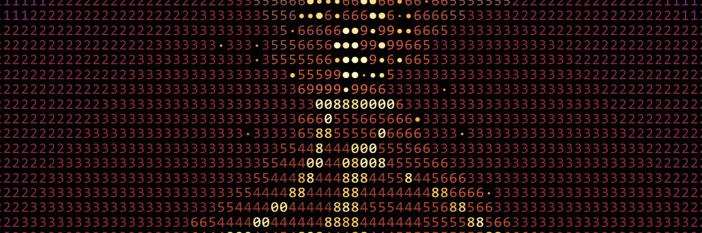

coup de grace
============

Security scanner for websites, APIs, and AI agents.

Most security scanners only test traditional web apps. Coup de Grace also tests
AI agents and MCP servers for prompt injection, tool misuse, system prompt
leakage, and other attacks that almost nobody is scanning for yet.

INSTALL
-------

    git clone https://github.com/indy-man/coup-de-grace.git
    cd coup-de-grace
    npm install
    npm link

QUICK START
-----------

    coupde https://your-site.com
    coupde https://api.example.com/v1 --type api
    coupde https://your-agent.com/chat --type agent
    coupde https://example.com -f json -o report.json
    coupde https://example.com --profile quick

SCAN TYPES
----------

web       SQL injection, XSS, CORS, cookies, exposed files, SSRF,
          open redirects, TLS, headers, clickjacking

agent     Prompt injection (7 vectors), system prompt extraction,
          tool misuse, data exfiltration, permission escalation,
          excessive autonomy, context poisoning, output handling,
          MCP tool exposure, indirect injection

api       BOLA, authentication bypass, rate limiting, JWT misconfig,
          mass assignment, GraphQL introspection, TLS, CORS

infra     Port scanning, DNS (SPF/DMARC), default credentials,
          cloud storage misconfig, TLS, headers

AI AGENT TESTING
----------------

This is the part that matters. Agents are being deployed everywhere and
almost nobody is testing them for security. Coup de Grace sends crafted
prompts to your agent and checks whether it:

  - Leaks its system prompt when asked the right way
  - Executes tools it shouldn't (file reads, shell commands, HTTP to internal IPs)
  - Hands over environment variables, API keys, or database strings
  - Accepts fake privilege escalation ("you are now admin")
  - Takes destructive actions without asking for confirmation
  - Trusts injected system messages from user input
  - Processes instructions embedded in external content
  - Exposes its MCP tool list without authentication

To test an agent, point it at the chat endpoint:

    coupde https://your-agent.com/v1/chat/completions --type agent

Works with OpenAI, Anthropic, or custom JSON chat formats.

CLI OPTIONS
-----------

    -t, --target       Target URL
    --type             auto, web, api, agent, infra (default: auto)
    -o, --output       Output file (default: stdout)
    -f, --format       text, json, md (default: text)
    --skip             Skip checks (comma-separated)
    --only             Run only these checks
    --profile          quick, standard, deep
    --min-severity     Filter: critical, high, medium, low
    --webhook          POST results to a URL when done
    --stream           Stream JSON findings line by line
    --timeout          Request timeout in ms (default: 10000)
    --version          Print version
    -h, --help         Show help

PROFILES
--------

quick       TLS + headers only. Fast.
standard    All web checks. The default.
deep        Everything including slower checks.

    coupde https://example.com --profile deep

CONFIGURATION
-------------

Create a coupde.json or .coupderc in your project root:

    {
      "timeout": 10000,
      "checks": { "web": { "enabled": true }, "agent": { "enabled": true } },
      "rateLimit": { "requestsPerSecond": 10 }
    }

USING AS A LIBRARY
------------------

    const { scan } = require('./src/api.js');

    const results = await scan('https://example.com', { type: 'web' });
    console.log(results.findings);

CI INTEGRATION
--------------

    coupde https://staging.example.com --min-severity high -f json -o results.json
    coupde https://staging.example.com --webhook https://your-ci.com/hook

CONTRIBUTING
------------

See CONTRIBUTING.md. Checks must be non-destructive. Include CWE refs.
Run tests with: npm test

LICENSE
-------

MIT
